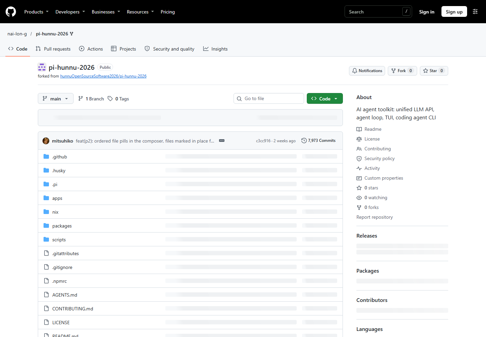
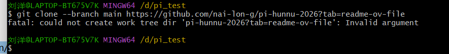
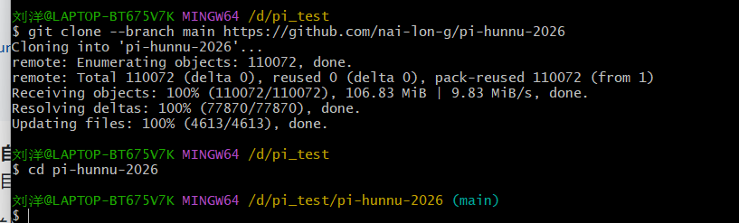
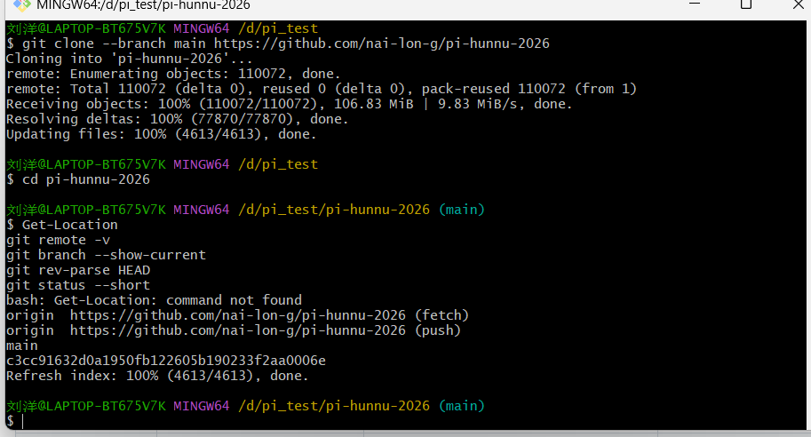
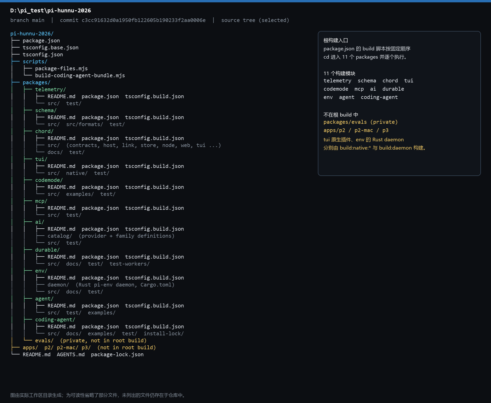
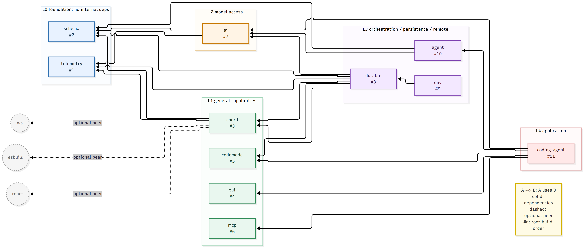
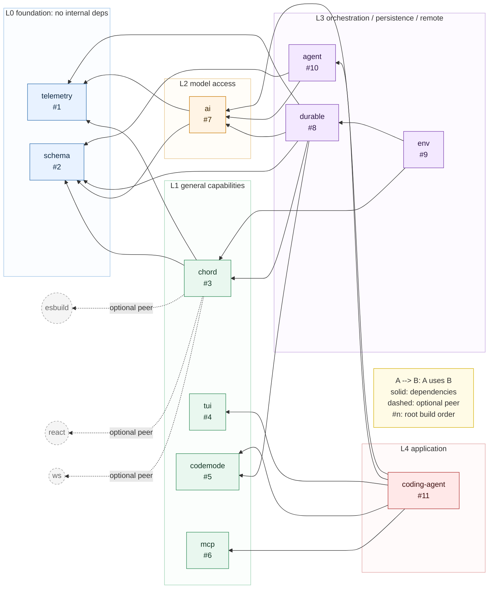

# 实践课2：组织建仓与源码分析

- 姓名：刘洋
- GitHub：L-Y-LEARN
- 小组代码仓库：<https://github.com/nai-lon-g/pi-hunnu-2026>
- 实际 clone 地址：<https://github.com/nai-lon-g/pi-hunnu-2026.git>
- 分析版本：`main` 分支，commit `c3cc91632d0a1950fb122605b190233f2aa0006e`
- 本人重点分析模块：`agent`、`ai`、`coding-agent`；同时对 `schema`、`telemetry` 的调用点做了交叉核对

> 说明：本报告以本地工作区 `D:\pi_test\pi-hunnu-2026` 的实际代码为准。README 只作为线索，遇到描述与代码不一致时，以 `package.json`、`tsconfig.build.json` 和 `src/` 中的 import/实现为准。文中的行号均对应上面的 commit。

## 1. 源码获取与版本核验

### 1.1 组织仓库与 clone 过程

组织仓库为 `nai-lon-g/pi-hunnu-2026`，是课程仓库 `hunnuOpenSourceSoftware2026/pi-hunnu-2026` 的 fork。仓库首页显示默认分支 `main`、提交 `c3cc916`，与本地 `git log -1` 一致。



*图 1：组织仓库首页（Public、fork 来源、main 分支、最新提交 c3cc916）。*

第一次 clone 时，我把浏览器地址栏里的 `?tab=readme-ov-file` 一并带进了命令：

```text
git clone --branch main https://github.com/nai-lon-g/pi-hunnu-2026?tab=readme-ov-file
fatal: could not create work tree dir 'pi-hunnu-2026?tab=readme-ov-file': Invalid argument
```

Windows 不允许目录名包含 `?`，因此失败。这个错误与仓库本身无关，是 URL 查询参数被当成了路径的一部分。



*图 2：把 `?tab=readme-ov-file` 带进 clone 地址后，Windows 报“Invalid argument”。*

去掉查询参数后重新执行，clone 成功：

```text
git clone --branch main https://github.com/nai-lon-g/pi-hunnu-2026.git
cd pi-hunnu-2026
```



*图 3：使用干净的 `.git` 地址 clone 成功，共收到 4613 个文件。*

clone 完成后，我核对了远端地址、当前分支和 HEAD：

```text
git remote -v
origin  https://github.com/nai-lon-g/pi-hunnu-2026 (fetch)
origin  https://github.com/nai-lon-g/pi-hunnu-2026 (push)
git branch --show-current
main
git rev-parse HEAD
c3cc91632d0a1950fb122605b190233f2aa0006e
```



*图 4：`git remote -v`、当前分支 `main` 与完整 commit `c3cc916...0006e`。*

### 1.2 源码目录与版本差异

实际 `packages/` 下有 12 个目录：作业清单中的 11 个构建模块全部存在，另有 1 个私有包 `evals`。根目录还有 `apps/p2`、`apps/p2-mac`、`apps/p3` 三个应用目录，它们不在根 `build` 链中。



*图 5：源码目录结构（按实际工作区生成，节选；未列出的文件仍存在）。*

与作业表格、根 README 的差异如下：

| 项目 | 实际情况 | 对分析的影响 |
|---|---|---|
| 作业清单的 11 个模块 | `telemetry`、`schema`、`chord`、`tui`、`codemode`、`mcp`、`ai`、`durable`、`env`、`agent`、`coding-agent` 全部存在 | 按 11 个模块逐一分析 |
| `packages/evals` | `@earendil-works/pi-evals`，`private: true`，有 `eval`/`test` 脚本，不在根 `build` 中 | 不计入 11 个构建模块，但它是“实际代码比清单多”的差异 |
| `apps/p2`、`p2-mac`、`p3` | 应用目录，根 `build` 不构建它们 | 根 `build` 只覆盖 `packages/*` 中的 11 个包 |
| 根 README 的包表 | 只列了 chord、telemetry、ai、durable、agent、coding-agent、tui 共 7 个 | README 不是完整清单；schema、codemode、mcp、env 在 `package.json` 的 build 链里，但未出现在该表 |
| `env` 的 `bin/` | 源码 clone 中没有 `bin/`；`build` 只跑 `tsc`，`build:daemon` 才用 Cargo 编译 Rust daemon | “根 build 产物”不包含 env daemon；发布包才带 `bin/` |
| `tui` 的 native | `build` 只跑 `tsc`；`build:native:darwin/linux/win32` 才编译原生插件 | 根 build 不生成 native prebuild |

因此，后文的“11 个模块”严格对应根 `build` 脚本中的 11 个 `cd ... && npm run build`，不把 `evals` 和 `apps/*` 混入。

## 2. 构建总览

### 2.1 根目录 `npm run build` 读取什么、做什么

根 `package.json` 的 `workspaces` 声明了 `packages/*`、`apps/*` 以及几个示例目录；`build` 脚本没有使用 `npm --workspace`，而是一串显式的 `cd`：

```text
telemetry → schema → chord → tui → codemode → mcp → ai → durable → env → agent → coding-agent
```

对应脚本在 `package.json:15`。它读取/依赖的东西可以分成四类：

1. **根 `package.json`**：读取 `workspaces` 和 `scripts.build`，决定“按什么顺序、进入哪些目录”。
2. **各子包的 `package.json`**：每次 `cd` 后执行该包的 `npm run build`，由 npm 读取该包的 `scripts`、`dependencies`、`devDependencies`。
3. **TypeScript 配置**：每个 `tsc -p tsconfig.build.json` 读取该包的 `tsconfig.build.json`，后者 `extends` 根 `tsconfig.base.json`。公共配置是 `target: ES2024`、`module: Node16`、`declaration: true`、`declarationMap/sourceMap`（`tsconfig.base.json:3-16`）。
4. **已安装的依赖**：`node_modules` 中的 `tsc`、`esbuild`，以及 workspace 包之间的符号链接。根 `build` 本身不执行 `npm install`。

它实际做的工作：

- 依次进入 11 个包，执行各自的 `build`；全部是串行，没有并行，也没有 `tsc -b` 的项目引用增量构建。
- 对 10 个包，`build` 就是 `tsc -p tsconfig.build.json`，把 `src/**/*.ts` 编译到各自的 `dist/`，同时生成 `.d.ts`、`.d.ts.map`、`.js.map`。
- 对 `ai`，`build` 先联网刷新模型目录，再调用 `build:offline`；后者做数据校验、`tsc`，并把 `src/providers/data` 复制到 `dist/providers/data`。
- 对 `coding-agent`，先 `tsc`，再给 `cli.js`/`rpc-entry.js` 加可执行位并复制主题、图片、HTML 模板，最后用 esbuild 生成 `dist/bundle` 和启动器。
- 不执行 `clean`，不执行测试，不构建 `tui` 的 native 插件，不构建 `env` 的 Rust daemon，也不构建 `apps/*`。

注意：根 `tsconfig.json` 设置了 `noEmit: true`，它是给 `npm run check` 的 `tsc --noEmit` 用的，不是根 `build` 的配置。根 `build` 也不读取 `package-lock.json` 来做版本决策；锁文件只影响此前 `npm install` 装进来的依赖。

前置条件：Node.js `>=22.19.0`（根 `engines` 与各包一致），先执行 `npm install --ignore-scripts` 生成 workspace 链接和 `node_modules/.bin/tsc`。在干净 clone 上直接 `npm run build` 会因为找不到 `tsc` 或 workspace 包而失败。这一点是我在读脚本时确认的，不是从 README 推断的。

### 2.2 各模块的 build 与产物

| 子文件夹 | 代码主要实现什么功能 | 本模块 build 执行什么、生成什么 | 直接依赖哪些内部模块 | 依据文件或代码位置 |
|---|---|---|---|---|
| `telemetry` | 与厂商无关的 telemetry 契约：`TelemetryContext`/`TelemetrySpan` 回调式 API、NOOP 实现、内存参考实现、计数器/直方图、跨进程 carrier 与 span link、类型化 schema、测试套件 | `tsc -p tsconfig.build.json`；继承 base，`outDir: dist`，生成 `dist/index.js`、`dist/index.d.ts` 以及 `memory`、`metrics`、`noop`、`render`、`testing/*` 等子路径产物；不跑测试 | 无 | `packages/telemetry/package.json:31`；`tsconfig.build.json:4-7`；`src/index.ts:102`；`src/memory.ts:313` |
| `schema` | JSON Schema builders 与校验器：把 schema 编译成普通闭包，不使用 `eval`；支持 Draft 2020-12/7、format 可选子路径、coercion、JSON Pointer 错误路径；运行时零依赖 | `tsc -p tsconfig.build.json`；生成 `dist/` 下的 `index`、`builders`、`compiler`、`validator`、`formats/*` 等 JS 与声明文件。`ajv`、`zod`、`typebox` 等只在 `devDependencies`，用于测试对照，不进入运行时 | 无 | `packages/schema/package.json:29`、`:50`；`src/validator.ts:14`；`src/compiler.ts` |
| `chord` | 跨进程对象运行时：contract/facet/host/reference、documents 与事务、derives/jobs、memory/IPC/WebSocket link、store 与 SQLite、插件发现/构建/热重载、HTTP/workers/web/tui surfaces | `tsc -p tsconfig.build.json`；生成 `dist/` 及大量子路径入口（`/http`、`/workers`、`/plugins`、`/app`、`/web`、`/react`、`/tui`、`/sqlite` 等）。不做 bundling，不复制静态资源 | `schema`、`telemetry` | `packages/chord/package.json:151`、`:172`、`:176-190`；`src/host/host.ts:537`；`src/node/plugins/build.ts:87`；`src/store/store.ts:61` |
| `tui` | 终端 UI 框架：差分渲染、主屏/备用屏、CSI 2026 同步输出、Component 模型、Editor/Markdown/Image/SelectList 等组件、键绑定、自动补全、鼠标与滚动 | `tsc -p tsconfig.build.json`；生成 `dist/`。`build` 不编译 native；`build:native:darwin/linux/win32` 才分别调用 shell 脚本或 `native/win32/build.mjs` | 无 | `packages/tui/package.json:9-12`；`src/tui.ts:504`；`src/tui-main-screen.ts:127`；`src/tui-alt-screen.ts:203` |
| `codemode` | 在 QuickJS（编译到 WASM）中执行模型写的 JavaScript；只暴露注入的 `tools`；嵌套工具调用不进入 LLM 上下文；提供 Node/Bun、Cloudflare、内联三种 sandbox，以及声明生成和源码解析 | `tsc -p tsconfig.build.json`；生成 `dist/`，并因 `files` 显式包含 `src/cloudflare-modules.d.ts` 而带上 Cloudflare 环境声明。不复制 wasm，wasm 由 `quickjs-wasi` 依赖提供 | 无 | `packages/codemode/package.json:46`；`src/runtime/host.ts:84`；`src/runtime/execution.ts:460`；`src/runtime/remote.ts:273` |
| `mcp` | 独立的 Model Context Protocol 客户端：JSON-RPC 关联、初始化、超时/取消；stdio、Streamable HTTP、Pipe、内存测试 transport；OAuth；工具 schema 归一化和输出限长 | `tsc -p tsconfig.build.json`；生成 `dist/` 及 `index`、`oauth`、`testing` 子路径。不依赖官方 MCP SDK | 无 | `packages/mcp/package.json:34`；`src/client.ts:155`；`src/transports/stdio.ts:69`；`src/transports/streamable-http.ts:248` |
| `ai` | 多 provider 的统一 LLM API：provider 工厂、模型目录、认证解析、流式事件、工具调用/参数校验、图片/分类、token 与成本、telemetry | `npm run generate-models` 联网抓取 models.dev、OpenRouter、Vercel AI Gateway、NVIDIA、Radius 等目录，写 `src/models.generated.ts`、`src/providers/*.models.ts`、`src/providers/data/*.json`；随后 `build:offline` 做 `check:model-data`、`tsc`、清空并复制 `dist/providers/data`。根 `build` 走联网版；根 `build:offline` 只走离线部分 | `schema`、`telemetry` | `packages/ai/package.json:72-77`；`catalog/generate.ts`；`catalog/sources/index.ts`；`src/models.ts:1059` |
| `durable` | 持久化 agent harness：conversation/turn/tool/task 在展示前先提交；崩溃后 `resume()` 从 checkpoint 继续；Chord document 状态、Memory/IndexedDB/JSONL/SQLite 存储；`ExecutionEnv` 接口、Code Mode、compaction/hooks/fork | `tsc -p tsconfig.build.json`；生成 `dist/` 及 `/env`、`/codemode`、`/storage/*`、`/tools` 等子路径。不复制存储文件，不跑测试 | `chord`、`ai`、`codemode`、`schema`、`telemetry` | `packages/durable/package.json:133`、`:166`；`src/harness/harness.ts:611-613`；`src/env/index.ts:377` |
| `env` | Pi Durable 的远程执行环境：通过 SSH 连接远端，部署并校验 Rust daemon；`RemoteExecutionEnv` 把文件、命令、终端、watch 操作转发到远端；含 host key 校验和 daemon SHA-256 校验 | `tsc -p tsconfig.build.json`；只生成 `dist/`。根 `build` 不构建 daemon；`build:daemon` 单独执行 `cargo build --manifest-path daemon/Cargo.toml --locked`，测试使用 `daemon/target/debug/pi-env` | `chord`、`durable`（`/env` 子路径） | `packages/env/package.json:26`、`:47`；`src/remote-env.ts:354`；`src/connection.ts:229`；`src/ssh.ts:535` |
| `agent` | 有状态 agent 核心：维护 `AgentMessage[]`、系统提示和工具状态；`Agent` 封装 prompt/continue/abort；`agentLoop` 负责流式事件、工具调用、steering/follow-up；只在大模型调用边界转换成 LLM message | `tsc -p tsconfig.build.json`；生成 `dist/`。`prepublishOnly` 只再跑一次 `build`，没有 clean | `ai`、`schema` | `packages/agent/package.json:21`、`:25`；`src/agent.ts:194`；`src/agent-loop.ts:111`；`src/types.ts:17` |
| `coding-agent` | 面向用户的 coding agent：CLI 参数、交互式 TUI、print/RPC 模式、`AgentSession` 与 `SessionManager`、扩展/技能/主题、内置工具、provider 登录、MCP 与 codemode 集成、SDK 导出 | `build:unbundled`：`tsc` → 给 `dist/cli.js`/`dist/rpc-entry.js` 加可执行位 → 复制主题、图片、export-html 模板；然后 `scripts/build-coding-agent-bundle.mjs` 用 esbuild 打包成 `dist/bundle/`（`cli-runtime.js`、`index.js`、`rpc-entry.js`、lazy OAuth/Bedrock entry、codemode worker 等）并生成启动器 `cli.js`。`build:binary` 是独立的 Bun 单文件构建，不在根 `build` 中 | `agent`、`ai`、`codemode`、`mcp`、`tui` | `packages/coding-agent/package.json:33-36`；`src/main.ts:611`；`src/core/sdk.ts:2`；`src/core/agent-session.ts:409`；`scripts/build-coding-agent-bundle.mjs` |

补充两点，避免把“有依赖”误读成“所有子路径都依赖”：

- `chord` 的 `react`、`ws`、`esbuild` 是 **optional peerDependencies**（`peerDependenciesMeta` 中 `optional: true`）。它们只在 `/react`、WebSocket link、`/plugins` 等子路径使用；普通 `import "@earendil-works/chord"` 不会加载它们。图中的虚线只表示这层可选关系。
- 11 个模块之间 **没有内部 devDependency 或 optionalDependency**。`schema` 的 ajv/zod/typebox、`ai` 的 canvas、`chord` 的 react/ws 测试依赖等，都是包内开发依赖，不构成模块间的运行时边。

## 3. 模块层级与依赖关系图

### 3.1 层级划分依据

我按“职责 + 在依赖图中的深度”把 11 个模块分成 5 层。这个分层是分析用的，不是构建顺序；节点里的 `#n` 才是根 `build` 的序号。

- **L0 基础契约层**：`telemetry`、`schema`。它们没有任何内部依赖，只提供契约/校验能力，是最稳定的底座。
- **L1 通用能力层**：`chord`、`tui`、`codemode`、`mcp`。`chord` 只依赖 L0；其余三个不依赖内部模块，分别解决对象运行时、终端 UI、JS 沙箱和 MCP 协议。
- **L2 模型接入层**：`ai`。它只依赖 L0，但职责是“把不同 provider 归一化成统一的流式 API”，是 L3/L4 的共同上游，所以单独成层。
- **L3 编排、持久化与远程执行层**：`durable`、`agent`、`env`。`durable` 组合 chord/ai/codemode；`agent` 组合 ai；`env` 在 durable 的 `ExecutionEnv` 之上做 SSH 远程实现。
- **L4 应用层**：`coding-agent`。它只作为最终使用方，组合 agent/ai/codemode/mcp/tui，不再被其他模块依赖。

因此，这张图不是“目录层级图”，而是“使用方 → 被依赖方”的依赖图：箭头从使用方指向被依赖方，实线表示 `dependencies` 中的直接依赖，虚线表示 `chord` 的可选 peer，灰色圆圈是不属于 11 个模块的外部包。

### 3.2 依赖关系图



*图 6：11 个模块的层级与直接依赖。读法：`A --> B` 表示 A 使用 B；实线为直接依赖，虚线为可选 peer；`#n` 为根 build 顺序。*

可编辑源文件：[assets/module-dependencies.mmd](assets/module-dependencies.mmd)。该文件用 Mermaid `flowchart RL` 编写，箭头方向与上图一致；`assets/mermaid-config.json` 是渲染配置。

<details>
<summary>点击展开 Mermaid 图源</summary>



</details>

### 3.3 图的依据与边界

图中有 18 条实线。我把每个包的 `package.json` 依赖清单与 `src/**/*.ts` 中的 `from "@earendil-works/..."` 做了双向核对，18 条实线都能同时找到“清单声明”和“源码 import”：

| 使用方 | 被依赖方 | 源码证据（示例） |
|---|---|---|
| `chord` | `schema` | `src/contracts/schema.ts:21` 重新导出 schema builders |
| `chord` | `telemetry` | `src/context/index.ts:1` 导入 `NOOP_TELEMETRY_CONTEXT` |
| `ai` | `schema` | `src/providers/compat-schema.ts:12` 导入 schema 类型 |
| `ai` | `telemetry` | `src/telemetry.ts:10` 导入 telemetry 类型 |
| `durable` | `chord` | `src/storage/store/commit.ts:22` 导入 chord 的 store 类型 |
| `durable` | `ai` | `src/types.ts:5` 导入 ai 的 `Message`/`Models` |
| `durable` | `codemode` | `src/codemode/describe.ts:9` 导入 `CodemodeJsonSchema` |
| `durable` | `schema` | `src/harness/tool.ts` 导入 `pi-schema/formats` |
| `durable` | `telemetry` | `src/harness/harness.ts` 使用 telemetry |
| `env` | `chord` | `src/list-files.ts` 导入 `chord/context` |
| `env` | `durable` | `src/errors.ts` 导入 `pi-durable/env` |
| `agent` | `ai` | `src/agent.ts:14` 导入 ai 的模型/消息类型 |
| `agent` | `schema` | `src/types.ts:17` 导入 `Static` |
| `coding-agent` | `agent` | `src/core/sdk.ts:2` 导入 `Agent` |
| `coding-agent` | `ai` | `src/main.ts:9` 导入 `modelsAreEqual` 等 |
| `coding-agent` | `codemode` | `src/extensions/codemode/execute.ts:26` 导入 codemode |
| `coding-agent` | `mcp` | `src/core/mcp-servers.ts:15` 导入 MCP 类型 |
| `coding-agent` | `tui` | `src/main.ts:10` 导入 `setCapabilityOverrides` |

这张图不包含：

- `evals`、`apps/*`：不在根 build 链，也不属于作业清单的 11 个模块。
- `tui` 的 native 插件、`env` 的 Rust daemon：它们是 native/外部构建产物，不是 TypeScript 模块间的依赖。
- 开发依赖：11 个模块之间没有内部 devDependency；图中的虚线只画了 `chord` 的三个 optional peer，且用灰色圆圈区分“外部包”。

## 4. 三个问题

### 4.1 根目录与子模块中的 `npm run build` 分别读取什么配置、执行什么工作？

**根目录的 `npm run build`** 读取根 `package.json` 的 `workspaces` 与 `scripts.build`，然后按固定顺序 `cd` 到 11 个子目录执行 `npm run build`。它不读取根 `tsconfig.json`（那是 `npm run check` 的 `noEmit` 配置），也不做 `npm install`、`clean`、测试或 native 构建。它的核心作用是“排序 + 调度”，真正编译的是子包。

**子模块的 `npm run build`** 读取本包 `package.json` 的 `scripts.build` 和本包 `tsconfig.build.json`。后者继承根 `tsconfig.base.json`，把 `src/**/*.ts` 编译到 `dist/`，生成 ESM JS、`.d.ts` 和 source map。`durable`、`env`、`agent`、`coding-agent` 还在 `tsconfig.build.json` 的 `paths` 中直接指向依赖包的 `../*/dist/*.d.ts`，例如 `agent` 指向 `../ai/dist/index.d.ts`、`coding-agent` 指向 `../agent/dist/index.d.ts`。这使编译期就要求依赖包“已经 build 过”。

三个特殊子包：

- `ai`：`build` = `generate-models` + `build:offline`。前者读取 `catalog/` 下的 provider/family 定义，联网抓取 models.dev、OpenRouter、Vercel AI Gateway、NVIDIA、Radius 等目录，写 `src/models.generated.ts`、`src/providers/*.models.ts`、`src/providers/data/*.json`；后者校验数据、`tsc`、复制 data 到 `dist/providers/data`。
- `coding-agent`：`build` = `build:unbundled` + esbuild bundle。`build:unbundled` 先 `tsc` 到 `dist/`，给 CLI/RPC 入口加可执行位，复制主题/图片/HTML 模板；bundle 脚本再以 `dist/cli.js`、`dist/index.js`、`dist/rpc-entry.js` 等为 entry，生成 `dist/bundle` 和 `cli.js` 启动器，并校验没有意外的 external import。
- `env` / `tui`：`build` 只做 TypeScript 部分。`env` 的 Rust daemon 由 `build:daemon` 单独用 Cargo 编译；`tui` 的 native 插件由 `build:native:*` 单独编译。根 `build` 不覆盖这两个 native 步骤。

因此，根 `build` 的输出是“11 个包的 `dist/`（其中 ai 带 data、coding-agent 带 bundle）”，不是“所有可发布产物”。发布前还要看 `prepublishOnly`、`build:daemon`、`build:native:*`、`build:binary` 等脚本。

### 4.2 构建顺序和模块依赖有什么关系？相邻构建的模块是否一定互相依赖？

构建顺序是依赖 DAG 的一个线性化，但脚本没有做严格的拓扑排序，而是“先基础、再通用、再模型/持久化、最后应用”的人工排序。依赖约束只能说明“被依赖者必须在前”，不能说明“排在一起的模块一定互相依赖”。

逐个检查 10 对相邻模块：

| 相邻对 | 后者是否直接依赖前者？ | 依据 |
|---|---|---|
| `telemetry → schema` | 否 | `schema` 没有内部依赖，二者是并列的 L0 |
| `schema → chord` | 是 | `chord` 的 `dependencies` 含 `pi-schema`，`src/contracts/schema.ts` 直接 import |
| `chord → tui` | 否 | `tui` 没有内部依赖，`chord` 也不依赖 `tui` |
| `tui → codemode` | 否 | `codemode` 没有内部依赖，两者互不引用 |
| `codemode → mcp` | 否 | `mcp` 没有内部依赖，两者互不引用 |
| `mcp → ai` | 否 | `ai` 只依赖 `schema`/`telemetry`，不依赖 `mcp` |
| `ai → durable` | 是 | `durable` 的 `dependencies` 含 `pi-ai`，`src/types.ts` 直接 import |
| `durable → env` | 是 | `env` 的 `dependencies` 含 `pi-durable`，`src/errors.ts` 使用 `pi-durable/env` |
| `env → agent` | 否 | `agent` 只依赖 `ai`/`schema`，不依赖 `env` |
| `agent → coding-agent` | 是 | `coding-agent` 的 `dependencies` 含 `pi-agent-core`，`src/core/sdk.ts` 直接 import `Agent` |

10 对里只有 4 对是真正的直接依赖，6 对只是“构建顺序相邻”。最明显的反例是 `env → agent`：`agent` 只需要 `ai` 和 `schema`，完全可以在 `ai` 之后、`durable` 之前构建；脚本把它放到 `env` 之后，是为了让“应用侧”的 `agent` 紧挨着 `coding-agent`，属于可读性/分组的排序选择，不是依赖强制。同理，`tui`、`codemode`、`mcp` 三个独立包被插在 `chord` 和 `ai` 之间，也不会影响正确性，只要它们在 `coding-agent` 之前完成即可。

这也解释了为什么顺序不能随便打乱：`chord` 依赖 `schema` 和 `telemetry` 的 `dist` 声明，`durable` 依赖 `chord`/`ai`/`codemode` 的 `dist`，`coding-agent` 依赖 `agent`/`ai`/`codemode`/`mcp`/`tui` 的 `dist`。如果先构建 `coding-agent`，TypeScript 会找不到 `../agent/dist/index.d.ts` 等声明文件。反过来，独立模块的先后顺序可以变，这正是“拓扑顺序不唯一”的体现。

### 4.3 选择一条涉及至少三个模块的依赖路径，说明这些模块如何分工

选择路径：

```text
coding-agent → agent → ai → schema
```

这条路径在源码中逐级可见：`coding-agent/src/core/sdk.ts:2` 导入 `Agent`；`agent/src/agent.ts:14` 导入 `pi-ai`；`ai/src/providers/compat-schema.ts:12` 导入 `pi-schema`。四个模块的分工如下：

1. **`coding-agent`：交互与会话外壳。** 它解析 CLI 参数、选择模型/会话、加载设置与扩展、创建 `AgentSession`，把用户输入变成 prompt，把 `Agent` 的事件渲染成 TUI 或 print/RPC 输出。它不实现模型协议，也不实现 agent 循环；这些通过 `agent` 和 `ai` 完成。证据：`src/main.ts:611` 的 `main()`、`src/core/agent-session.ts:409` 的 `AgentSession`、`src/core/sdk.ts:2` 的 `Agent` 导入。
2. **`agent`：状态机与工具编排。** `Agent` 维护 `AgentMessage[]`、系统提示、工具列表和流式状态；`runAgentLoop` 负责“请求模型 → 解析文本/工具调用 → 执行工具 → 把结果写回上下文 → 继续下一轮”。它只在大模型调用边界把 `AgentMessage` 转成 `ai` 的 `Message`，因此可以适配不同 provider。证据：`src/agent.ts:194`、`src/agent-loop.ts:111`、`src/agent-loop.ts:20` 导入 `EventStream`/`validateToolArguments`。
3. **`ai`：provider 适配与流式协议。** 它把 OpenAI、Anthropic、Google、Bedrock 等不同 API 归一化成统一的 `streamSimple`/事件流，处理认证、模型目录、token/成本、工具声明和参数校验。`agent` 只依赖这个统一接口，不需要知道具体 provider。证据：`src/models.ts:1059` 的 `createModels()`、`src/compat.ts:278` 的 `streamSimple()`、`src/providers/compat-schema.ts:12` 的 schema 使用。
4. **`schema`：工具参数的校验底座。** `ai` 用 `schema` 的 builders 描述工具参数，用 `compile()` 把 JSON Schema 编译成闭包校验器；模型返回的参数在进入工具前由它校验/收窄类型。它不依赖任何 pi 包，因此位于链路末端。证据：`src/validator.ts:14` 的 `compile()`、`src/compiler.ts`、`agent/src/types.ts:17` 对 `Static` 的使用。

一次工具调用的实际数据流可以概括为：

```text
用户输入
  → coding-agent 组装 AgentSession / prompt
  → Agent.prompt()
  → runAgentLoop()
  → ai.streamSimple() 请求具体 provider
  → 模型返回 tool call
  → ai 用 schema 校验工具参数
  → agent 执行工具并把 toolResult 写回上下文
  → 下一轮生成
  → coding-agent 渲染最终文本/工具结果
```

这条路径故意没有选 `coding-agent → durable → ...`，因为 `coding-agent` 的 `package.json` 和 `src/` 都没有直接依赖 `durable`/`env`；`durable` 是另一条独立的产品线（持久化 harness），`env` 又建立在 `durable` 之上。把不存在的边画进链路会让分析看起来完整，但不符合代码。这个取舍也是我在核对 import 后做出的。

## 5. 分析结论与限制

1. **根 build 是“顺序脚本”，不是“项目引用构建”。** 它靠 `cd` 和 npm 脚本串行执行，依赖关系由各包的 `tsconfig.build.json`/`package.json` 隐式约束。优点是简单、可读；缺点是没有增量、没有并行、不会自动 clean，干净 clone 必须先安装依赖。
2. **构建顺序只保证“依赖在前”，不保证“相邻即依赖”。** 11 个模块的依赖 DAG 有 18 条直接边，但 10 对相邻构建里只有 4 对是直接依赖。`agent` 被放在 `env` 之后就是典型的排序选择。
3. **`ai` 是唯一带“联网生成”步骤的模块。** 根 `build` 会刷新模型目录；`build:offline` 则依赖已有 `src/providers/data`。如果离线环境直接跑根 `build`，会在 `generate-models` 阶段失败；这时应使用 `npm run build:offline`，或先 `npm run hydrate:model-data`。
4. **`env`、`tui` 的 native 产物不在根 build 中。** `env` 的 `bin/` 在源码 clone 中不存在，`build:daemon` 才会生成 `daemon/target/debug/pi-env`；`tui` 的 native 插件由 `build:native:*` 生成。把根 build 当成“完整发布构建”会漏掉这两块。
5. **本次分析以静态源码/清单核对为主。** 我没有在 `D:\pi_test` 工作区执行完整 `npm install && npm run build`，因为该目录是用户的 clone，且 `ai` 的 build 会联网改写生成文件；报告中的 build 行为来自 `package.json` 脚本、`tsconfig.build.json`、构建脚本源码和实际 import 的交叉核对。若要在本机复现，建议在单独副本中执行 `npm install --ignore-scripts`，再按根脚本顺序构建。

## 6. 复核清单

- `git remote -v`、`git branch --show-current`、`git rev-parse HEAD` 与截图一致。
- 11 个模块的 `package.json` 均存在，`build` 脚本与根 `build` 链一一对应。
- 每个模块的 `tsconfig.build.json` 均 `extends` 根 `tsconfig.base.json`，除 `ai`/`tui` 等个别 include 差异外，输出目录统一为 `dist`。
- 18 条内部依赖边均能在 `package.json` 的 `dependencies` 和 `src/` 的 import 中找到对应。
- 11 个模块之间没有内部 `devDependencies`/`optionalDependencies`；`chord` 的 `esbuild`/`react`/`ws` 是 `peerDependenciesMeta.optional = true` 的外部 peer。
- 图源 `.mmd` 可在 Mermaid Live Editor 或本地 `mmdc` 中重新渲染；`assets/mermaid-config.json` 只影响布局，不改变依赖语义。
